<p align="center">
  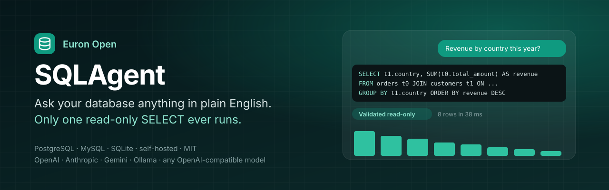
</p>

<p align="center">
  
  <a href="LICENSE"></a>
  
  
  
  
  
  
</p>

<p align="center">
  <a href="https://github.com/euron-sde-team/euron-open-sqlagent/stargazers"></a>
  <a href="https://github.com/euron-sde-team/euron-open-sqlagent/fork"></a>
  <a href="https://github.com/euron-sde-team/euron-open-sqlagent/watchers"></a>
  <br>
  <a href="https://github.com/euron-sde-team/euron-open-sqlagent/issues"></a>
  <a href="https://github.com/euron-sde-team/euron-open-sqlagent/pulls"></a>
  <a href="https://github.com/euron-sde-team/euron-open-sqlagent/commits/main"></a>
  
  <br>
  <a href="#built-by-the-team-behind-euron"></a>
</p>

<p align="center">
  <b><a href="#-quickstart">Quickstart</a></b> ·
  <b><a href="#️-architecture">Architecture</a></b> ·
  <b><a href="#-explore-the-repository">Explore the repo</a></b> ·
  <b><a href="docs/api/openapi.yaml">API reference</a></b> ·
  <b><a href="#️-deploy-to-aws">Deploy</a></b> ·
  <b><a href="docs/architecture/security.md">Security</a></b> ·
  <b><a href="#-documentation">Docs</a></b>
</p>

**Euron Open SQLAgent** is an open-source, MIT-licensed database assistant, part of the
open-source initiative of **ENGAGESPHERE TECHNOLOGY PRIVATE LIMITED**. Connect a PostgreSQL,
MySQL or SQLite database, ask a question in plain English, and get back one SQL query, a
plain explanation of what it does, the result as a table, and a chart when the shape fits.
Follow up with "and last year?" and it remembers the conversation.

It is built for the moment someone asks "can I point an AI at our production database?",
so the safety is structural rather than a prompt:

- Every query is parsed in its dialect and must be exactly one read-only `SELECT`, or it never
  reaches the database.
- The database session itself is opened read-only, so a write that slipped past the parser
  still fails at the database.
- The planner's estimate is checked against a scan limit before running, the database
  enforces the timeout, and every query is in an append-only audit log.

The whole stack runs on a laptop with no AWS account and no model key (a deterministic mock
model answers until you add OpenAI, Anthropic, Gemini, Ollama or any compatible endpoint), and
deploys to AWS from the same Terraform.

<p align="center">
  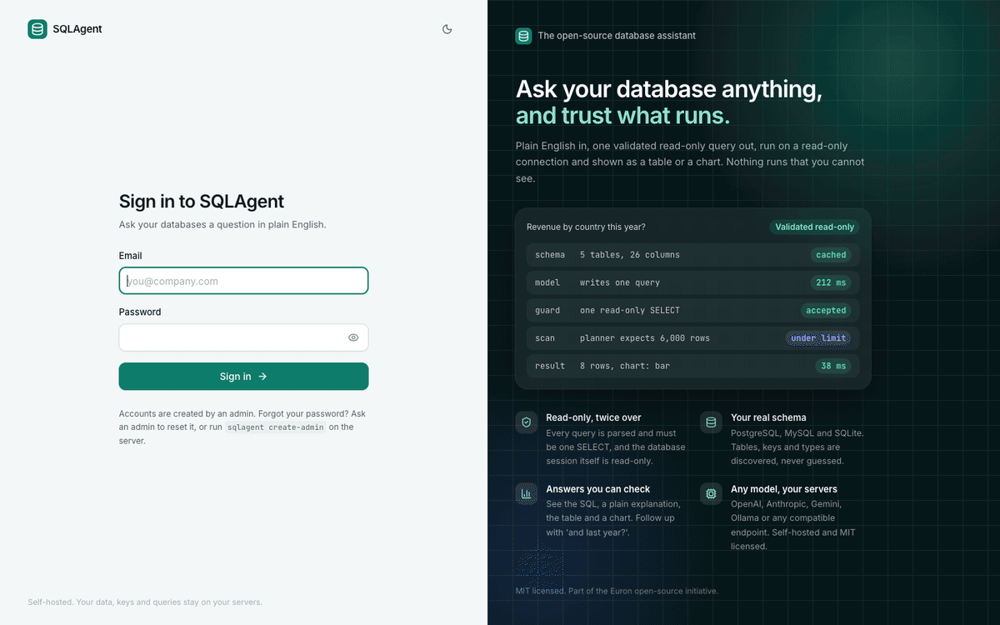
</p>

> [!NOTE]
> Everything in the tour ran for real: Docker Compose on a laptop, the question asked in the
> browser and answered by the worker against a seeded PostgreSQL database, with S3, KMS and
> Secrets Manager emulated locally and provisioned by the same Terraform modules that build
> production. `make up && make demo` reproduces it.

<h3 align="center">Built by the team behind Euron</h3>

<p align="center">Euron Open SQLAgent comes from the people who build these platforms. If you like how this repository is built, come and see what we build with it.</p>

<p align="center">
  <a href="https://euron.one"><picture><source media="(prefers-color-scheme: dark)" srcset="docs/assets/brand/euron-dark.svg"></picture></a>
  <a href="https://euronsystems.com"><picture><source media="(prefers-color-scheme: dark)" srcset="docs/assets/brand/euron-systems-dark.svg"></picture></a>
  <a href="https://alphaeuron.com"><picture><source media="(prefers-color-scheme: dark)" srcset="docs/assets/brand/alpha-euron-dark.svg"></picture></a>
</p>

<p align="center">
  <a href="https://www.instagram.com/euron_official"></a>
  <a href="https://www.linkedin.com/company/euronone/posts/"></a>
  <a href="https://x.com/euron712"></a>
  <a href="https://www.youtube.com/@Euron-official"></a>
  <a href="https://whatsapp.com/channel/0029VaeeJwq9RZAfPW9P2l07"></a>
</p>

---

## 📚 Table of contents

- [Why Euron Open SQLAgent](#-why-euron-open-sqlagent)
- [At a glance](#-at-a-glance)
- [Screenshots](#️-screenshots)
- [Features](#-features)
- [Architecture](#️-architecture)
  - [A question, end to end](#a-question-end-to-end)
- [Tech stack](#-tech-stack)
- [Prerequisites](#-prerequisites)
- [Quickstart](#-quickstart)
- [Explore the repository](#-explore-the-repository)
- [API](#-api)
- [Configuration](#️-configuration)
- [Deploy to AWS](#️-deploy-to-aws)
- [Security model](#-security-model)
- [Testing](#-testing)
- [Documentation](#-documentation)
- [Roadmap](#️-roadmap)
- [FAQ](#-faq)
- [Contributing, security and license](#-contributing-security-and-license)

---

## 💡 Why Euron Open SQLAgent

Most of the questions a business asks of its data are one query away, and the people asking
cannot write it. Text-to-SQL closes that gap, but the usual demo hands a model a database
login and hopes. Euron Open SQLAgent is the version you can put in front of a production
replica:

- **Read-only, twice over.** A parser in the database's own dialect accepts only one
  `SELECT`, and the session is read-only at the database. Either lock alone stops a write.
- **Nothing hidden.** Every answer shows the SQL that ran, says in plain words what it does,
  and records who asked, what ran and how many rows came back.
- **Your real schema.** Tables, columns, keys, indexes and row counts are read from the
  database itself, so the model writes against what exists, not a guess.
- **Any model, your servers.** OpenAI, Anthropic, Gemini, Ollama or any OpenAI-compatible
  endpoint per project, with keys sealed by KMS. A deterministic mock runs everything,
  including the tests and this repository's demo, without a key.
- **Production-grade on AWS.** The Terraform builds the whole stack (VPC, RDS, ElastiCache,
  S3, KMS, ECS Fargate behind an ALB with WAF, alarms), and the same modules provision the
  local emulator.

## 📊 At a glance

| | |
| --- | --- |
| **Apps** | Web dashboard, API, question worker, scheduler, Python SDK and CLI |
| **Databases** | PostgreSQL, MySQL, SQLite (uploaded) |
| **Model providers** | OpenAI, Anthropic, Gemini, Ollama, any OpenAI-compatible endpoint, built-in mock |
| **Safety** | SQL guard per dialect, read-only sessions, planner scan limit, database timeout, row cap, append-only audit |
| **Tenancy** | Organizations, projects, roles (admin, editor, viewer), scoped API keys |
| **Infrastructure** | 10 Terraform modules, 3 environments (local emulator, AWS dev, AWS prod) |
| **Tests** | 184 API unit, 54 web unit, 59 integration (90% coverage, run under 4 backend combinations), 6 browser end-to-end |
| **License** | MIT |

## 🖼️ Screenshots

<table>
  <tr>
    <td width="50%">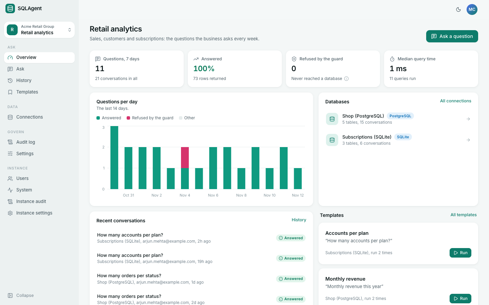<br><sub><b>Overview.</b> Questions per day, answered rate, guard refusals, query time, databases and templates.</sub></td>
    <td width="50%">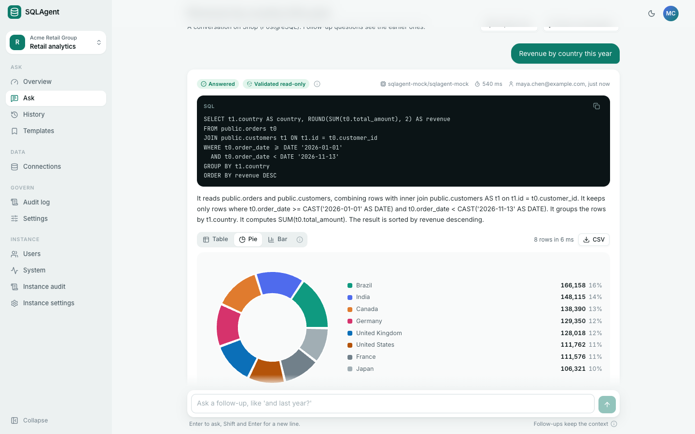<br><sub><b>Ask.</b> One validated read-only query, what it does in plain words, the result and a chart.</sub></td>
  </tr>
  <tr>
    <td>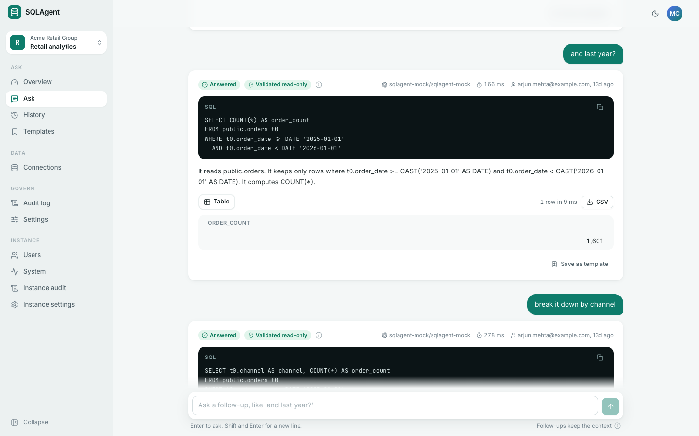<br><sub><b>Follow-ups.</b> "and last year?" and "break it down by channel" keep the context.</sub></td>
    <td>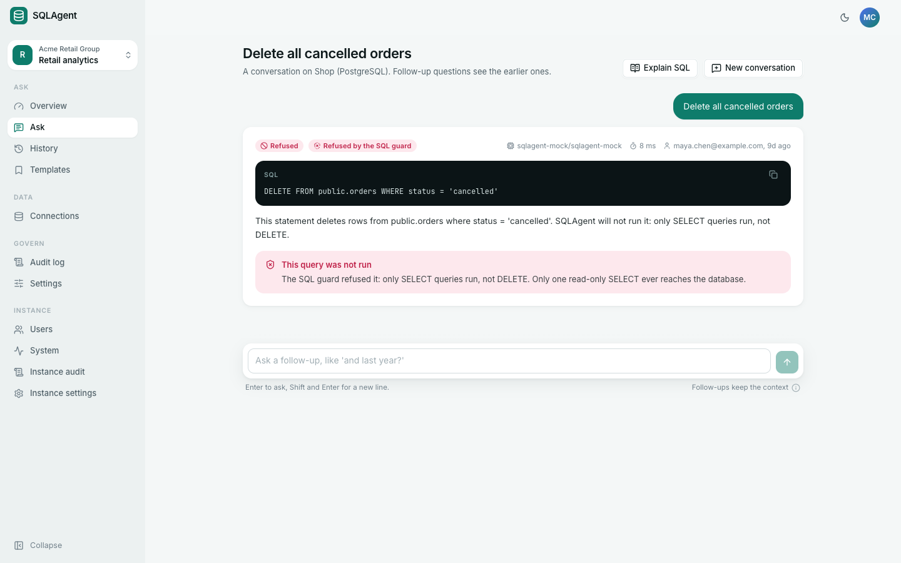<br><sub><b>Refused.</b> A write never reaches the database, and the reason is shown.</sub></td>
  </tr>
  <tr>
    <td>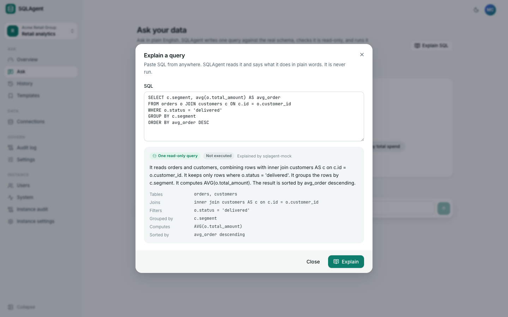<br><sub><b>Explain SQL.</b> Paste any query and read what it does. It is never run.</sub></td>
    <td>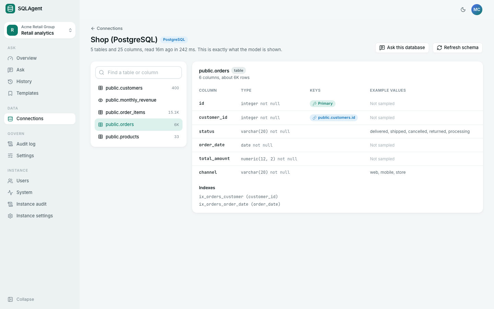<br><sub><b>Schema.</b> Exactly what the model is shown: columns, keys, indexes, row counts.</sub></td>
  </tr>
  <tr>
    <td>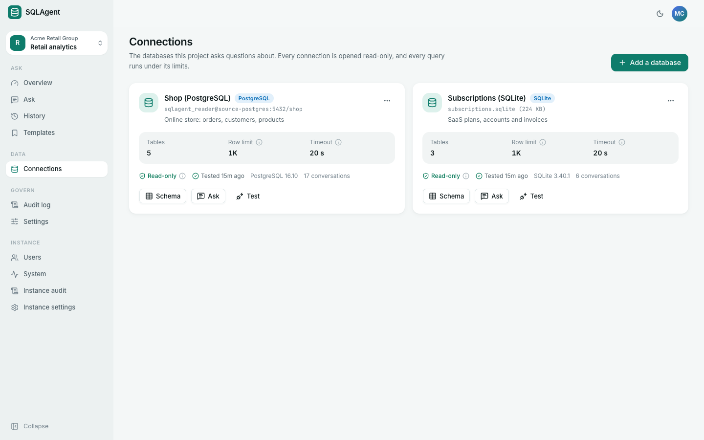<br><sub><b>Connections.</b> Read-only logins, sealed passwords, per-connection limits.</sub></td>
    <td>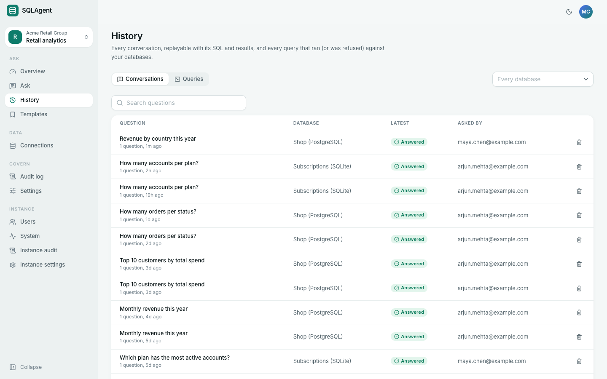<br><sub><b>History.</b> Every conversation and every query, filterable by outcome.</sub></td>
  </tr>
  <tr>
    <td>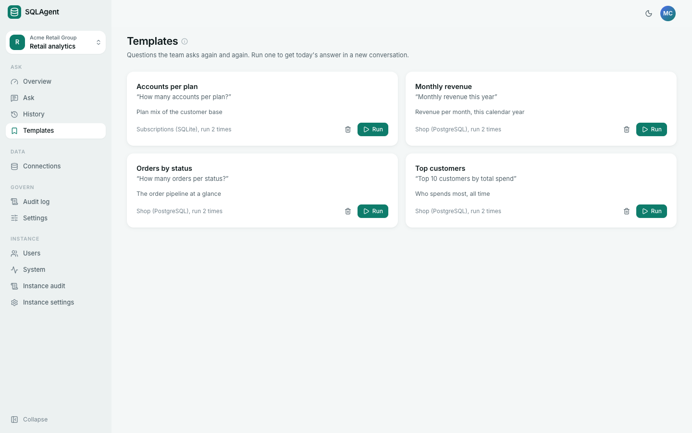<br><sub><b>Templates.</b> Save an answer, run it again with one click.</sub></td>
    <td>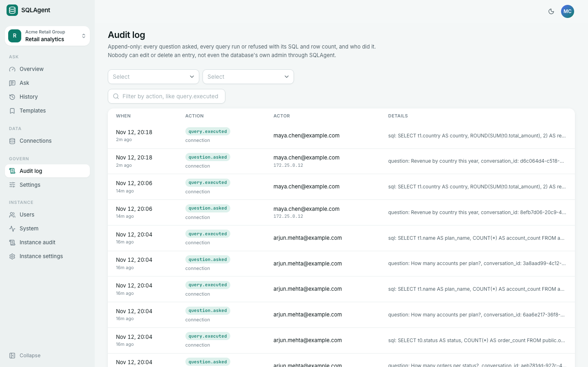<br><sub><b>Audit log.</b> Append-only, enforced by the database.</sub></td>
  </tr>
  <tr>
    <td>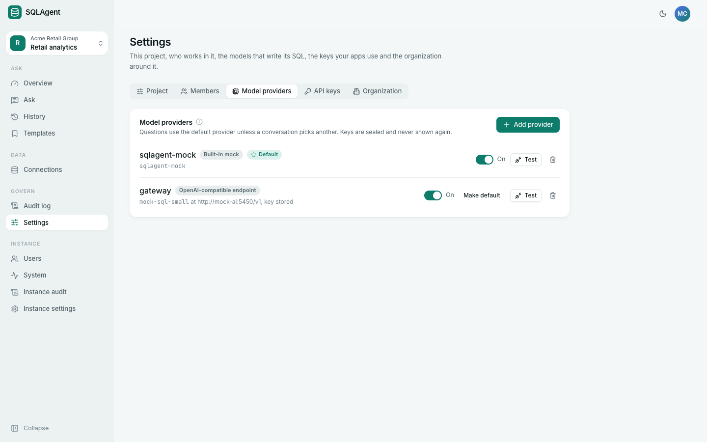<br><sub><b>Model providers.</b> Per project, keys sealed, the mock until you add one.</sub></td>
    <td>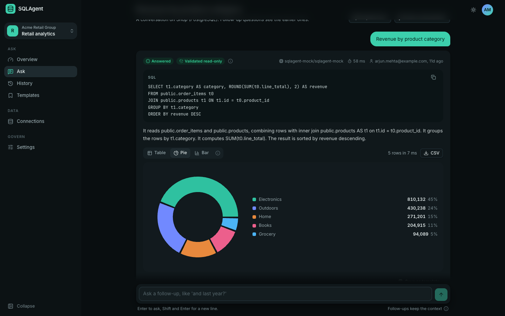<br><sub><b>Dark theme.</b> Every screen, light and dark, desktop and phone.</sub></td>
  </tr>
</table>

## ✨ Features

| Area | What you get |
| --- | --- |
| **Ask** | Questions in plain English, one SQL query per answer with a plain explanation, follow-ups that keep the conversation, a choice of provider per conversation, answers queued and answered by workers so a slow model never holds a request |
| **Results** | Paged tables, CSV export, chart suggestions (bar, line, pie) when the shape fits, results stored as snapshots so a page or an export never re-runs the query |
| **Safety** | The SQL guard (one statement, `SELECT` only, no denied functions or table functions, per dialect), read-only sessions, the planner's scan estimate against a limit, the database's own statement timeout, a row cap, all per connection |
| **Connections** | PostgreSQL and MySQL by host, SQLite by upload; connection tests that report the round trip, server version and that the session is read-only; metadata addresses refused |
| **Schema** | Discovery of tables, views, columns, keys, indexes and row counts, optional sample values for low-cardinality text, refresh on demand and on a schedule, a schema explorer that shows exactly what the model sees |
| **SQL tools** | Generate, validate, explain and execute endpoints for apps that bring their own SQL |
| **Templates** | Saved questions per connection, run again from the dashboard, the API or the CLI |
| **Access** | Organizations and projects, roles (admin, editor, viewer), API keys with `read`, `query` and `manage` scopes, member notices by mail |
| **Audit and usage** | Append-only audit log per project and per instance, daily usage rollups (questions, queries, tokens), Prometheus metrics, JSON logs |
| **SDK and CLI** | `euron-sqlagent` for Python (sync and async) and `sqlagent-cli` that exits non-zero when a query stops working |

## 🏗️ Architecture

<p align="center">
  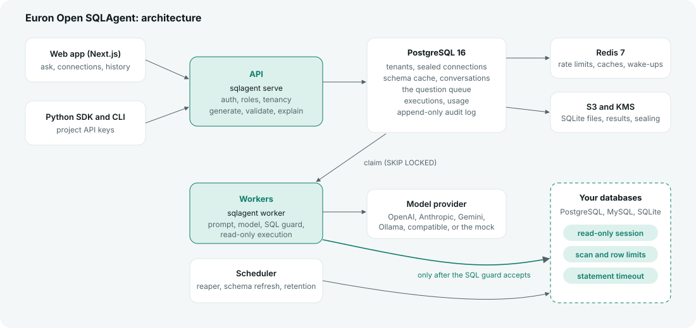
</p>

One Python package and one image run three roles, picked by the command:

- **api** (`sqlagent serve`): the REST API under `/api/v1`, sessions and API keys,
  connection tests, schema discovery and the direct SQL endpoints.
- **worker** (`sqlagent worker`): claims queued questions from Postgres
  (`FOR UPDATE SKIP LOCKED` with leases) and answers them.
- **scheduler** (`sqlagent scheduler`): reaps expired leases, refreshes schemas, applies
  retention and publishes queue gauges.

The web app is Next.js; it proxies `/api` to the API so the session cookie stays first-party.

### A question, end to end

<p align="center">
  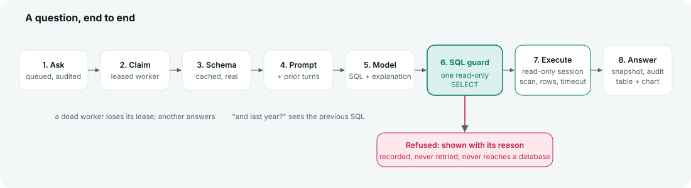
</p>

1. The API writes the question as `queued`, publishes a wake-up and waits up to `wait`
   seconds.
2. A worker claims it, builds the prompt from the cached schema and the conversation's
   earlier turns, and asks the project's model for one JSON object: SQL and explanation.
3. The SQL guard parses the query in the connection's dialect. A refusal is recorded and
   shown; it is never retried with different SQL.
4. On a read-only session, the planner's estimate is checked against the scan limit, the
   query runs under the timeout, and at most the row limit is fetched.
5. The result goes to object storage; the execution row and an audit entry are written in
   one transaction; a chart is suggested; the waiting request returns the answer.

[High-level design](docs/architecture/HLD.md) · [Low-level design](docs/architecture/LLD.md) ·
[SQL guard](docs/architecture/sql-guard.md) · [Text to SQL](docs/architecture/text-to-sql.md) ·
[Question queue](docs/architecture/question-queue.md)

## 🧰 Tech stack

| Layer | Choice | Why |
| --- | --- | --- |
| API, worker, scheduler | Python 3.12, FastAPI, SQLAlchemy 2 (async), Alembic | Typed end to end (`mypy --strict`); the database drivers for every source live in Python |
| SQL guard | sqlglot | A real parser per dialect, not regular expressions ([ADR 0003](docs/architecture/adr/0003-sqlglot-for-the-guard.md)) |
| Queue | Postgres, `SKIP LOCKED`, leases | No broker to run; transactional with the question it answers ([ADR 0002](docs/architecture/adr/0002-postgres-as-the-question-queue.md)) |
| Results | Snapshots in S3 (or local disk) | Pages and exports never re-run a query ([ADR 0005](docs/architecture/adr/0005-result-snapshots-in-object-storage.md)) |
| Web | Next.js 15, React 19, Tailwind 4, TanStack Query, Recharts | Types generated from the OpenAPI document |
| Cache | Redis 7 (optional) | Rate limits, the schema cache's fast layer, pub/sub wake-ups; never the only copy |
| AWS | ECS Fargate (ARM64), ALB, WAF, RDS, ElastiCache, S3, KMS, Secrets Manager, SES, CloudWatch | Managed building blocks, least-privilege roles |
| Infrastructure as code | Terraform | The same modules build AWS and the local emulator |
| Local AWS | Floci, Mailpit, `mockai` | Full stack on a laptop, mail you can read, a model without a key |
| Tests | pytest, Vitest, Playwright, Puppeteer | Unit, integration against real databases, browser end-to-end, a QA sweep of every page |

## 📋 Prerequisites

| Tool | Version | Used for |
| --- | --- | --- |
| [Docker](https://docs.docker.com/get-docker/) with Compose v2 | 24+ | The local stack |
| [uv](https://docs.astral.sh/uv/) | 0.5+ | Running the API's tests outside Docker |
| [Node.js](https://nodejs.org/) and [pnpm](https://pnpm.io/) | 22 LTS, 9 | The web app's tests, e2e and the QA sweep |
| [Terraform](https://developer.hashicorp.com/terraform/install) | 1.16 | Only for deploying to AWS (local runs use a pinned container) |
| [AWS CLI](https://aws.amazon.com/cli/) | 2 | Only for deploying to AWS |

Free local ports (each overridable in `deploy/compose/.env`): 5410 (web), 5430 (API), 5442
(Postgres), 5479 (Redis), 5466 (AWS emulator), 5425 (Mailpit), 5450 (mock model), 5443 and
5406 (demo PostgreSQL and MySQL).

## 🚀 Quickstart

```bash
git clone https://github.com/euron-sde-team/euron-open-sqlagent.git
cd euron-open-sqlagent

make up      # build and start everything; Terraform provisions the AWS emulator first
make demo    # demo databases, people, connections and answered conversations; prints the logins
```

| Open | As |
| --- | --- |
| http://localhost:5410 | `maya.chen@example.com` (admin), `arjun.mehta@example.com` (editor) or `sofia.lopez@example.com` (viewer) |
| http://localhost:5430/docs | The interactive API reference |
| http://localhost:5425 | Every email the stack sends |

The password for every demo account is printed by `make demo` (it is generated by `make env`
and stored in `deploy/compose/.env`). Open **Retail analytics**, then **Ask**, pick
**Shop (PostgreSQL)** and ask "How many orders per status?". `make down` stops everything
and deletes the data.

[Full local guide](docs/guides/quickstart-local.md) ·
[Run locally against real AWS](docs/guides/local-with-aws.md) ·
[Troubleshooting](docs/guides/troubleshooting.md)

## 🧭 Explore the repository

```text
euron-open-sqlagent/
├── apps/
│   ├── api/                 FastAPI app, question worker and scheduler (one package)
│   │   └── src/
│   │       ├── sqlagent/
│   │       │   ├── sql/          the SQL guard, the describer, prompts, generate/validate/explain/execute
│   │       │   ├── chat/         conversations, the question queue, the answering engine
│   │       │   ├── connections/  sealed connections, read-only sessions, schema discovery, scan estimates
│   │       │   ├── schema/       the schema cache and the prompt's schema block
│   │       │   ├── executions/   running a query under its limits, snapshots, pages, CSV
│   │       │   ├── providers/    model providers, adapters per wire format, the mock planner
│   │       │   ├── charts/       chart suggestions from a result's shape
│   │       │   ├── audit/ usage/ templates/ projects/ orgs/ users/ auth/
│   │       │   ├── core/         config and boot guards, db, sealing, storage, cache, middleware
│   │       │   ├── migrations/   Alembic (including the append-only audit trigger)
│   │       │   └── worker.py cli.py main.py
│   │       └── mockai/       the deterministic model service (four wire formats)
│   └── web/                 Next.js dashboard
├── sdk/python/              euron-sqlagent client and sqlagent-cli
├── infra/terraform/         modules + envs (local-floci, aws-dev, aws-prod)
├── deploy/compose/          the local stack (Floci or real AWS overlay)
├── e2e/                     Playwright browser tests
├── docs/                    architecture, ADRs, guides, OpenAPI
└── scripts/                 deploy, test matrix, QA sweep, screenshots, sanitization check
```

**Where to start reading:**

| To understand | Read |
| --- | --- |
| Why a write can never run | `sql/guard.py`, then `connections/sources.py` (`open_sql`), then `tests/integration/test_safety.py` |
| How a question is answered | `chat/router.py` → `chat/queue.py` → `chat/engine.py` → `executions/service.py` |
| How the prompt is built | `schema/prompt.py` and `sql/prompt.py` |
| How limits are enforced | `executions/service.py` and `connections/sources.py` (scan estimates, timeouts) |
| How tenants are isolated | `projects/access.py`, then `tests/integration/test_access.py` |
| How it deploys | `infra/terraform/modules/service/main.tf`, then `scripts/aws-deploy.sh` |

Paths are under `apps/api/src/sqlagent/` or `apps/api/` unless they start with `infra/` or
`scripts/`. The [walkthrough](docs/guides/walkthrough.md) follows one question through the
code.

## 🔌 API

The [OpenAPI reference](docs/api/openapi.yaml) is generated from the FastAPI app
(`make openapi`), and a unit test fails if it drifts from the code. The web app's types are
generated from the same file. Apps authenticate with a project API key.

```bash
curl -X POST "localhost:5430/api/v1/projects/$PROJECT/chat" -H "X-API-Key: $KEY" \
  -H 'content-type: application/json' \
  -d '{"connection_id": "'$CONNECTION'", "question": "How many orders per status?", "wait": 30}'
```

```python
from euron_sqlagent import SQLAgent

client = SQLAgent(base_url="http://localhost:5430", api_key="sqa_...")
answer = client.ask("How many orders per status?", connection="Shop (PostgreSQL)")
print(answer.sql, answer.records())
```

[API integration guide](docs/guides/api-integration.md) · [Python SDK](sdk/python/README.md)

## ⚙️ Configuration

Every setting is an environment variable read once at start and validated. With
`ENVIRONMENT=production` the API, worker and scheduler refuse to boot unless all of these
hold:

- the session secret and API key pepper are random, long and different
- connection passwords and provider keys have a real key (KMS, or a random local master key)
- there is no endpoint override on real AWS
- cookies are secure
- mail is really delivered (SES or SMTP)
- result snapshots go to S3, which every replica can read

Per-connection limits (rows, scan rows, timeout, sample values) and per-project providers
are edited in the app. Every variable is documented in the
[configuration reference](docs/guides/configuration.md).

## ☁️ Deploy to AWS

```bash
cd infra/terraform/envs/aws-dev
cp terraform.tfvars.example terraform.tfvars   # region, name prefix, host name, certificate, mail domain
cd -
make aws-deploy ENV=aws-dev TAG=0.1.0                     # registries, images, infrastructure, migrations, rollout
make aws-admin ENV=aws-dev EMAIL=you@example.com          # the first admin
```

`aws-deploy` creates the image registries, builds and pushes the `api` and `web` images for
ARM64, applies the rest of the infrastructure, runs the migrations as a one-off ECS task and
waits for the api, worker, scheduler and web services to become stable.

| | aws-dev | aws-prod |
| --- | --- | --- |
| Availability zones | 2, one NAT | 3, NAT per zone |
| Database | single-AZ, 3-day backups | Multi-AZ, 14-day backups, deletion protection |
| Cache | one node | two nodes |
| Services | api 1 to 2, web 1 to 2, 1 worker | api 2 to 6, web 2 to 4, 2 workers |
| Logs | 14 days | 365 days, KMS-encrypted |

The full `aws-dev` environment is planned, applied, re-planned and destroyed against a
throwaway emulator (`make tf-aws-on-floci`).
[Deployment guide](docs/guides/deploy-aws.md) · [Operations](docs/guides/operations.md)

## 🔐 Security model

| Concern | How it is handled |
| --- | --- |
| Writes | The SQL guard accepts one read-only `SELECT` per dialect, and the session is read-only at the database (PostgreSQL `default_transaction_read_only`, MySQL `READ ONLY` transactions, SQLite `mode=ro` and `query_only`) |
| Runaway queries | The planner's estimate against a scan limit before running, the database's own statement timeout, a row cap |
| Credentials | Connection passwords and provider keys sealed with AES-GCM under KMS, bound to their record, never returned |
| Tenants | Organization and project scoping in the access layer; another tenant's ids are 404, swept by a test |
| Roles and keys | Admin, editor and viewer per project; API keys with `read`, `query` and `manage` scopes, hashed with a pepper |
| Outbound | Cloud metadata and link-local addresses refused for databases and providers |
| What a model sees | The schema block and, only if a connection opts in, sample values of low-cardinality text columns; never result rows |
| Audit | Append-only audit log; updates and deletes are rejected by a database trigger |
| Infrastructure | Private subnets, KMS everywhere, TLS-only private bucket, WAF, least-privilege task roles, checkov with no unexplained exceptions |

[Security](docs/architecture/security.md) · [Threat model](docs/architecture/threat-model.md) ·
Report vulnerabilities privately: see [SECURITY.md](SECURITY.md).

## 🧪 Testing

| Suite | What it proves | Run |
| --- | --- | --- |
| Unit (184 API, 54 web) | The SQL guard (66 cases across three dialects), prompts, the describer, the mock planner, every provider adapter, charts, config guards, sealing, the OpenAPI drift check, web logic | `make test` |
| Integration (59) | The real API and worker against Postgres, Redis, a demo PostgreSQL and MySQL server and SQLite files: every acceptance criterion, roles, isolation, the queue surviving a dead worker | `make test-integration` |
| Option matrix (4 runs) | The integration suite under local and KMS sealing, local disk and S3 storage | `make test-matrix` |
| Browser (6) | Sign-in, asking with a chart and a follow-up, a refused write, explain, schema, history, audit, templates, a viewer's read-only screens | `make e2e` |
| QA sweep | Every page for every role, light and dark, desktop and phone, with no console errors, failed requests or overflow | `make qa` |
| Infrastructure | `terraform validate` (3 environments), tflint, checkov (318 passed, 0 failed), apply and destroy on an emulator | `make tf-validate tf-lint tf-security tf-aws-on-floci` |

Unit and integration together cover 90% of the API. `make bench` on a laptop: the SQL guard
takes a median 354 us per query; a question to its answer on the demo database takes a
median 53 ms with the mock model (51 ms of it SQLAgent itself); discovering a 500-table,
6,999-column schema takes 0.57 s.

[Testing guide](docs/guides/testing.md)

## 📖 Documentation

| Architecture | Guides |
| --- | --- |
| [High-level design](docs/architecture/HLD.md) | [Quickstart (local)](docs/guides/quickstart-local.md) |
| [Low-level design](docs/architecture/LLD.md) | [Local against real AWS](docs/guides/local-with-aws.md) |
| [Data model](docs/architecture/data-model.md) | [Deploy to AWS](docs/guides/deploy-aws.md) |
| [SQL guard](docs/architecture/sql-guard.md) | [Configuration reference](docs/guides/configuration.md) |
| [Text to SQL](docs/architecture/text-to-sql.md) | [Operations](docs/guides/operations.md) |
| [Question queue](docs/architecture/question-queue.md) | [API integration](docs/guides/api-integration.md) |
| [Security](docs/architecture/security.md) | [Testing](docs/guides/testing.md) · [Troubleshooting](docs/guides/troubleshooting.md) |
| [Threat model](docs/architecture/threat-model.md) | [Code walkthrough](docs/guides/walkthrough.md) |
| [Decision records](docs/architecture/adr/) | [API reference (OpenAPI)](docs/api/openapi.yaml) |

## 🗺️ Roadmap

- More databases: MariaDB, SQL Server, DuckDB, ClickHouse, Snowflake, BigQuery, Redshift
- SSH tunnels to databases in private networks
- PII masking in results
- Query optimization suggestions from the execution plan
- Dashboards built from saved answers, and scheduled reports
- SSO (SAML and OIDC)
- Streaming answers from the model

Have an idea? [Open a feature request](https://github.com/euron-sde-team/euron-open-sqlagent/issues/new/choose).

## ❓ FAQ

<details>
<summary><b>Can it change my data?</b></summary>

Not through anything it runs. A query must parse as exactly one read-only `SELECT` in your
database's dialect, and the session is opened read-only by the database itself. Connect with
a login that has only read grants as well: that is the third lock, and the one you control.
</details>

<details>
<summary><b>Do I need a model key or an AWS account to try it?</b></summary>

No. A deterministic mock model answers the demo questions, and `make up` runs S3, KMS and
Secrets Manager on a local emulator provisioned by the same Terraform as production.
</details>

<details>
<summary><b>What does the model see of my data?</b></summary>

The schema (tables, columns, types, keys, row counts), the conversation's earlier questions
and SQL with a short summary of their results, and, only on connections where you turn it
on, a few sample values of low-cardinality text columns. Result rows are never sent. See
[text to SQL](docs/architecture/text-to-sql.md).
</details>

<details>
<summary><b>Can I use a model on my own servers?</b></summary>

Yes. Add an Ollama provider or any OpenAI-compatible endpoint (vLLM, a gateway) under
Settings, Model providers. Private addresses are allowed; cloud metadata addresses are not.
</details>

<details>
<summary><b>What happens if a query is slow?</b></summary>

Before it runs, the database's planner estimates how many rows it reads; over the
connection's scan limit, it is refused with the estimate. While it runs, the database
enforces the connection's timeout and cancels it. Either way the answer says why.
</details>

<details>
<summary><b>Can it run outside AWS?</b></summary>

Yes. The application also supports local disk storage, SMTP mail and a local master key, so
it runs anywhere with Postgres. The Terraform targets AWS.
</details>

## 🤝 Contributing, security and license

Contributions are welcome: read [CONTRIBUTING.md](CONTRIBUTING.md) and the
[code of conduct](CODE_OF_CONDUCT.md). Report security issues privately as described in
[SECURITY.md](SECURITY.md).

Released under the [MIT License](LICENSE). Copyright (c) 2026 ENGAGESPHERE TECHNOLOGY
PRIVATE LIMITED and the Euron Open SQLAgent contributors.

<p align="center">
  If Euron Open SQLAgent saves you time, <b><a href="https://github.com/euron-sde-team/euron-open-sqlagent/stargazers">⭐ star the repository</a></b>.
</p>
