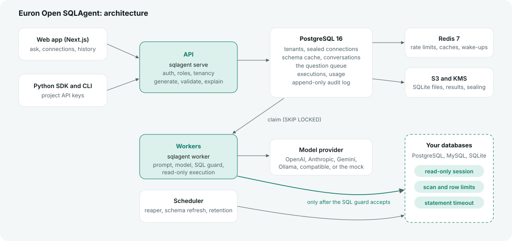
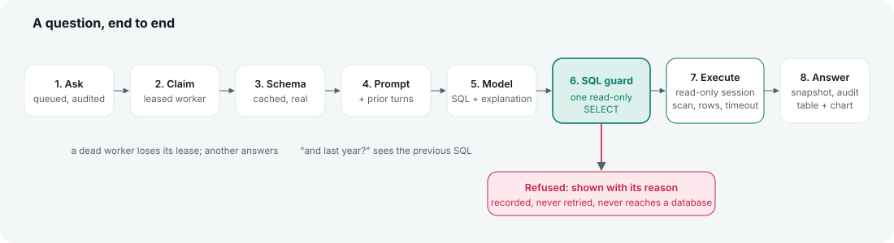

# High-level design

SQLAgent turns a question in plain English into one read-only SQL query against a database
someone connected, runs it safely, and shows the answer as a table or a chart. This page is
the map: the processes, how a question flows, where state lives, how it is cached, and how
it scales. [LLD.md](LLD.md) goes into the code.

## Processes

| Process | Command | Does | Replicas |
| --- | --- | --- | --- |
| API | `sqlagent serve` | REST API under `/api/v1`, sessions and API keys, connection tests, schema discovery on demand, the direct SQL endpoints (generate, validate, explain, execute) | Any, stateless |
| Worker | `sqlagent worker` | Claims queued questions from Postgres and answers them: prompt, model call, SQL guard, read-only execution, result snapshot, audit | Any, leased |
| Scheduler | `sqlagent scheduler` | Lease reaper, schema refresh, retention, queue gauges | One |
| Web | Next.js | The dashboard; proxies `/api` to the API | Any |
| Migrate | `sqlagent migrate` | Alembic migrations, before a release | One-off |

One Python package and one image serve the API, the worker and the scheduler; the command
picks the role ([ADR 0009](adr/0009-one-package-three-roles.md)).

## A question, end to end

1. **Ask.** `POST /api/v1/projects/{id}/chat` writes a `conversation_messages` row with
   status `queued` (and its conversation, for a new question), audits `question.asked`,
   publishes a wake-up and waits up to `wait` seconds for the answer.
2. **Claim.** A worker claims it with `FOR UPDATE SKIP LOCKED` and a lease
   ([question-queue.md](question-queue.md)).
3. **Schema.** The connection's schema comes from the schema cache (discovered from the
   database itself: tables, columns, keys, indexes, row counts, optionally sample values).
4. **Prompt.** The relevant tables are rendered into a schema block within a character
   budget, with the dialect, today's date and the conversation's prior turns (question, SQL,
   a short summary of the result) so follow-ups resolve ([text-to-sql.md](text-to-sql.md)).
5. **Model.** The project's provider (or the conversation's) answers with one JSON object:
   the SQL and a plain explanation.
6. **Guard.** The SQL guard parses the query in the connection's dialect and accepts only
   one read-only `SELECT` ([sql-guard.md](sql-guard.md)). A refusal is recorded and shown with
   its reason. It is never retried with different SQL.
7. **Execute.** On a connection the database itself holds read-only, the planner's estimate
   is checked against the scan limit, the statement runs under the timeout, and at most the
   row limit is fetched.
8. **Record.** The result goes to object storage as a snapshot, and the execution row and an
   append-only audit entry (SQL, status, row count, actor) are written in one transaction.
   A chart is suggested when the result's shape fits.
9. **Finish.** The worker writes the final state under its lease and publishes on the
   question's channel; the waiting API request returns the answer with its first page.

## State

| Store | Holds |
| --- | --- |
| PostgreSQL 16 | Everything durable: tenants, users, sealed connections and provider keys, the schema cache, conversations and the question queue, executions, templates, daily usage rollups, the append-only audit log |
| Object storage (S3, or local disk) | Uploaded SQLite databases and result snapshots. Rows keep only the key |
| Redis 7 (optional) | Rate limits, the schema cache's fast layer, the result page cache, pub/sub wake-ups. Nothing there is the only copy of anything |
| KMS (or a local key) | Seals connection passwords and provider keys, bound to their record |

## Caching

| What | Where | Key | TTL | Invalidation |
| --- | --- | --- | --- | --- |
| A connection's schema | Redis (process memory without it) over the `schema_cache` row | `schema:<connection>:<refreshed_at>` | 1 hour | A refresh writes a new `refreshed_at`, so every reader moves to a new key at once; nothing is deleted. Tested in `test_a5_schema_refresh_sees_a_new_table` |
| A result's rows (pages, CSV) | Redis over the S3 snapshot | `result:<execution>` | 5 minutes | Never stale: a snapshot never changes after it is written |
| Local SQLite copies | Worker and API disk under `WORK_DIR` | hash of the object key | Process life | Keys are immutable: a new upload is a new key |
| Rate limits | Redis sliding window | `sqa:rl:questions:<project>` | 2 minutes | Time |
| Web data | TanStack Query in the browser | `["p", project, ...]` | `staleTime` per kind: live 2 s, lists 15 s, config 60 s, schemas and results 5 minutes | Mutations invalidate exactly the keys they touch |

The hot path of a question reads one indexed column (`refreshed_at`) and then the cache, not
the schema JSON. A Redis outage costs database reads and is counted in
`sqlagent_dependency_errors_total`; it never fails a request.

## Scaling and failure

- The API is stateless; run as many as needed behind the load balancer.
- Workers coordinate only through Postgres row locks and leases. A worker that dies loses
  its lease; the scheduler's reaper puts the question back (with backoff) or fails it after
  `MAX_ATTEMPTS` claims, so nothing is answered twice and nothing is lost.
- The scheduler is a single task; its work is idempotent, so a brief overlap during a
  deploy is harmless.
- A model provider outage is retried with backoff (rate limits, 5xx, timeouts) and then
  reported on the question. A customer database outage fails only the questions about it.
- Every statement against a customer database is bounded by its timeout, enforced by that
  database.

## Security boundaries

Covered in [security.md](security.md) and the [threat model](threat-model.md): two locks
for read-only (the guard and the read-only session), sealed credentials, tenant isolation in
the repository layer (another tenant's ids are 404), metadata addresses refused at connect
time, an append-only audit log the database protects.
